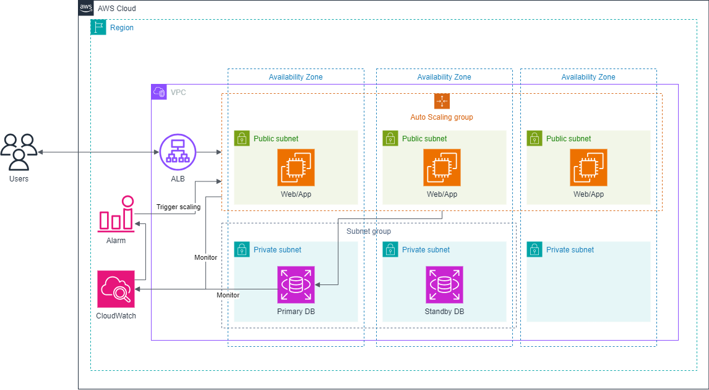
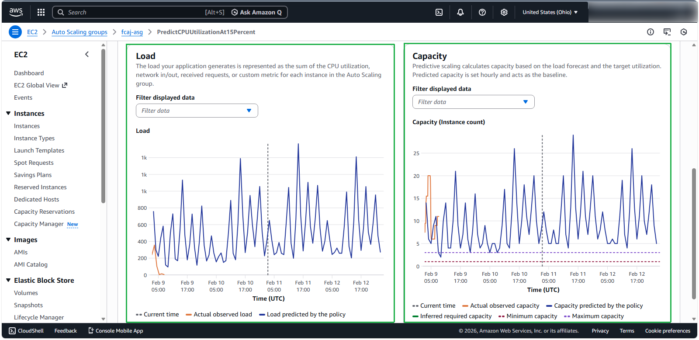
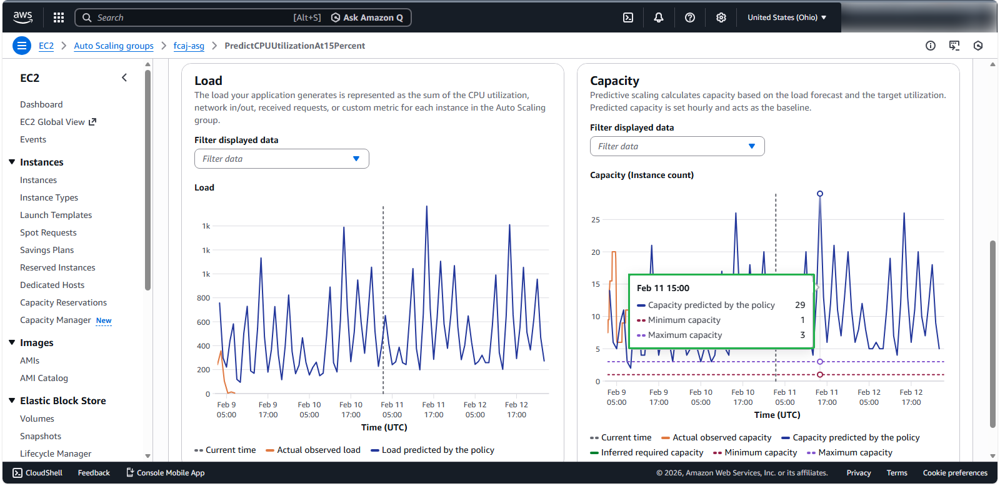

# AWS SAA Lab 06: Triển Khai Ứng Dụng FCAJ Management với Auto Scaling Group & Elastic Load Balancing

> **Mục tiêu ôn tập SAA**: Nắm vững kiến trúc Web 3-Tier có khả năng tự động mở rộng quy mô (Auto Scaling Group), cân bằng tải (Application Load Balancer), cơ sở dữ liệu có tính sẵn sàng cao (Multi-AZ RDS MySQL), và thử nghiệm 4 cơ chế Scaling: **Manual, Scheduled, Dynamic (Target Tracking), và Predictive Scaling**.

---

## 1. Sơ Đồ Kiến Trúc (Architecture Diagram)



### Các thành phần chính trong kiến trúc:
1. **Network Tier (VPC `10.0.0.0/16`)**:
   * **2 Public Subnets** (Multi-AZ: `us-east-1a`, `us-east-1b`) chứa Internet-facing Application Load Balancer (ALB) và Bastion/Management Host.
   * **2 Private Subnets (App Tier)** chứa các EC2 instances trong Auto Scaling Group.
   * **2 Private Subnets (Database Tier)** chứa RDS Multi-AZ MySQL instance.
2. **Load Balancing & Compute Tier**:
   * **Application Load Balancer (ALB)** tiếp nhận HTTP request cổng 80 từ Internet và định tuyến vào Target Group cổng 5000.
   * **Auto Scaling Group**: Quản lý các instance chạy Node.js (FCAJ Management app), tự động co giãn từ 1 đến 3 instances.
3. **Database Tier**:
   * **Amazon RDS MySQL 8.4 Multi-AZ**: Tính sẵn sàng cao (High Availability), tự động failover sang Secondary AZ nếu Primary gặp sự cố.
4. **Monitoring & Forecasting**:
   * **Amazon CloudWatch**: Thu thập số liệu hiệu năng CPU và dung lượng máy để đưa ra mô hình dự đoán tải **Predictive Scaling**.

---

## 2. 4 Cơ Chế Scaling Đã Kiểm Thử Trong Lab

### 2.1. Manual Scaling (Co giãn thủ công)
* Can thiệp trực tiếp bằng cách thay đổi giá trị **Desired capacity**, **Min**, **Max** trên AWS Console hoặc CLI.
* Phù hợp khi biết trước sự kiện đặc biệt hoặc cần bảo trì, đưa toàn bộ hệ thống về 0 instance để tiết kiệm chi phí.

### 2.2. Scheduled Scaling (Co giãn theo lịch trình)
* Thiết lập **Scheduled Action** (ví dụ: `Rush-hour`) để tự động nâng dung lượng vào khung giờ cao điểm cố định trong ngày/tuần (ví dụ: giờ mở cửa thị trường chứng khoán, giờ flash sale).

### 2.3. Dynamic Scaling (Co giãn theo nhu cầu thực tế - Target Tracking)
* Sử dụng chính sách **Target Tracking Scaling Policy** bám theo chỉ số mục tiêu:
  * Metric: `ASGAverageCPUUtilization = 50%`
* CloudWatch tự động tạo 2 Alarm (`AlarmHigh` và `AlarmLow`) để tự động scale-out khi CPU vượt 50% và scale-in khi tải giảm.

### 2.4. Predictive Scaling (Co giãn dự đoán tương lai dựa trên Machine Learning)
* Sử dụng dữ liệu metric lịch sử (> 2 ngày) từ CloudWatch Custom Metrics (`WSCustomCPUUTILIZATION` và `WSCustomGroupInstances`) để học mô hình tải (traffic pattern).
* Thuật toán tự động dự đoán trước số instance cần thiết và kích hoạt khởi chạy sớm trước 1 phút (`SchedulingBufferTime = 60s`), loại bỏ hoàn toàn độ trễ khởi động máy.

#### Biểu đồ dự báo tải và dung lượng máy:
| Biểu đồ tổng quan Forecast | Biểu đồ Load & Capacity chi tiết |
|:---:|:---:|
|  |  |

---

## 3. Hướng Dẫn Triển Khai Tự Động Bằng CloudFormation

Toàn bộ kiến trúc trên đã được đóng gói thành template CloudFormation chuẩn Infrastructure as Code (IaC) tại file [`cloudformation/lab06-fcaj-autoscaling.yaml`](./cloudformation/lab06-fcaj-autoscaling.yaml).

### Cách triển khai (Deploy):
```bash
aws cloudformation create-stack \
  --stack-name lab06-fcaj-autoscaling \
  --template-body file://cloudformation/lab06-fcaj-autoscaling.yaml \
  --parameters ParameterKey=KeyName,ParameterValue=d-key-SAA-common \
               ParameterKey=DBPassword,ParameterValue="jijika123" \
  --capabilities CAPABILITY_IAM \
  --region us-east-1
```

### Lấy thông tin đầu ra sau khi deploy:
```bash
aws cloudformation describe-stacks \
  --stack-name lab06-fcaj-autoscaling \
  --query "Stacks[0].Outputs" \
  --output table \
  --region us-east-1
```

### Xóa toàn bộ tài nguyên khi học xong (Tiết kiệm chi phí):
```bash
aws cloudformation delete-stack \
  --stack-name lab06-fcaj-autoscaling \
  --region us-east-1
```

---

## 4. Dữ Liệu Metric Dùng Cho Predictive Scaling

Thư mục [`metrics/`](./metrics/) chứa đầy đủ các file đã được format chuẩn:
* `prepare-metric-data.sh`: Script bash tự động tính toán timestamp lùi dần theo chu kỳ 5 phút và gán tên ASG.
* `metric-cpu.json`: Bộ 499 điểm dữ liệu đo CPU Utilization của nhóm ASG.
* `metric-instances.json`: Bộ dữ liệu lịch sử số lượng instance hoạt động.

Lệnh nạp metric lên CloudWatch:
```bash
aws cloudwatch put-metric-data --namespace 'FCAJ Custom Metrics' --metric-data file://metrics/metric-cpu.json --region us-east-1
aws cloudwatch put-metric-data --namespace 'FCAJ Custom Metrics' --metric-data file://metrics/metric-instances.json --region us-east-1
```

---

## 5. Các Điểm Cần Nhớ Cho Kỳ Thi SAA-C03 (Exam Tips)
1. **Multi-AZ RDS vs Read Replica**:
   * Multi-AZ dùng cho **High Availability** và **Disaster Recovery** (đồng bộ synchronous), không dùng để tăng tốc truy vấn đọc.
   * Read Replica dùng cho **Read Scalability** (bất đồng bộ asynchronous), có thể thăng cấp thành Standalone DB.
2. **Dynamic Scaling vs Predictive Scaling**:
   * Dynamic scaling mang tính **phản hồi (reactive)**: chỉ kích hoạt sau khi chỉ số chạm ngưỡng $\rightarrow$ có độ trễ khởi động instance.
   * Predictive scaling mang tính **chủ động (proactive)**: dùng mô hình ML dự đoán trước các chu kỳ tuần hoàn để khởi động instance trước khi tải ập đến.
3. **Security Group Best Practice**:
   * Web/App Security Group chỉ mở cổng 5000 cho nguồn là ALB Security Group (`SourceSecurityGroupId`).
   * Database Security Group chỉ mở cổng 3306 cho nguồn là App Security Group.
