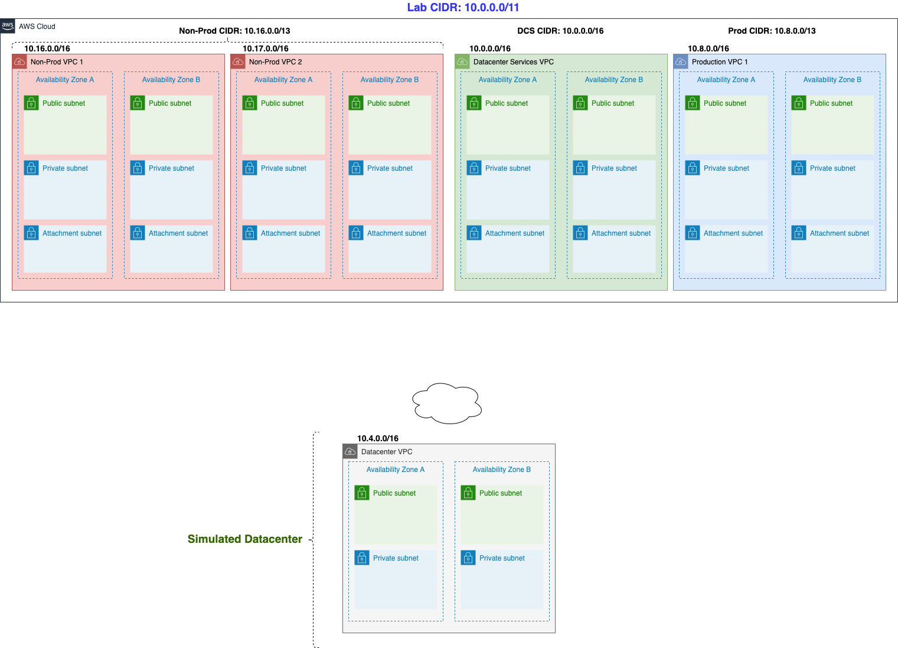

# Lab 92: VPC Components Deep Dive & Multi-VPC Hybrid Architecture

Tài liệu hướng dẫn triển khai, cấu trúc kiến trúc và ôn tập chứng chỉ AWS Solutions Architect Associate (SAA) / AWS Certified Advanced Networking - Specialty (ANS) cho bài thực hành **VPC Components Deep Dive**.

---

## 1. Sơ đồ kiến trúc (Architecture Overview)

Hệ thống được thiết kế theo mô hình **Multi-VPC Enterprise Hub-and-Spoke / Hybrid Cloud** chuẩn AWS với tổng dải mạng `10.0.0.0/11`:



### Bảng phân bổ mạng & VPC (IP Addressing Plan):

| Tên VPC (`lab92-*`) | Dải CIDR | Mục đích | Số Subnet | Route Tables | Gateways |
| :--- | :--- | :--- | :--- | :--- | :--- |
| **`lab92-np1`** | `10.16.0.0/16` | Môi trường Non-Production (Development) | 6 (2 Public, 2 Private, 2 Attach) | 3 Custom RTs | N/A (Route via DCS/TGW) |
| **`lab92-np2`** | `10.17.0.0/16` | Môi trường Non-Production (Testing/QA) | 6 (2 Public, 2 Private, 2 Attach) | 3 Custom RTs | N/A (Route via DCS/TGW) |
| **`lab92-p1`** | `10.8.0.0/16` | Môi trường Production | 6 (2 Public, 2 Private, 2 Attach) | 3 Custom RTs | N/A (Route via DCS/TGW) |
| **`lab92-dcs`** | `10.0.0.0/16` | Datacenter Shared Services (Central Egress / Shared VPC) | 6 (2 Public, 2 Private, 2 Attach) | 3 Custom RTs | 1 IGW (`lab92-igw-dcs`) + 1 NAT GW (`lab92-nat-sub-public-dcs`) |
| **`lab92-dc`** | `10.4.0.0/16` | Simulated On-Premises Datacenter | 6 (2 Public, 2 Private, 2 Attach) | 3 Custom RTs | 1 IGW (`lab92-igw-dc`) |

---

## 2. Quy chuẩn đặt tên tài nguyên (`lab92-*`)

Toàn bộ tài nguyên được chuẩn hóa theo định dạng nhất quán:

- **VPC**: `lab92-np1`, `lab92-np2`, `lab92-p1`, `lab92-dcs`, `lab92-dc`
- **Subnet**: `lab92-sub-[public|private]-[vpc]-[purpose]-az-[a|b]`
  - Ví dụ: `lab92-sub-public-np1-az-a`, `lab92-sub-private-np1-az-a`, `lab92-sub-private-np1-attach-az-a`
- **Route Table**: `lab92-rt-[public|private|attach]-[vpc]`
  - Ví dụ: `lab92-rt-public-np1`, `lab92-rt-private-np1`, `lab92-rt-attach-np1`
- **Gateways**:
  - Internet Gateway: `lab92-igw-dcs`, `lab92-igw-dc`
  - NAT Gateway: `lab92-nat-sub-public-dcs`
  - Elastic IP: `lab92-eip-dcs`
- **EC2 Test Servers (quản lý qua SSM Session Manager)**:
  - `lab92-ec2-dev` (NP1)
  - `lab92-ec2-test` (NP2)
  - `lab92-ec2-prod` (P1)
  - `lab92-ec2-dcs` (DCS)
  - `lab92-ec2-dc` (DC)

---

## 3. Cách triển khai bằng 1-Click CloudFormation

### Triển khai qua AWS CLI:
```bash
aws cloudformation create-stack \
  --stack-name lab92-vpc-tgw-stack \
  --template-body file://cloudformation/lab92-tgw-vpcs.yaml \
  --capabilities CAPABILITY_NAMED_IAM \
  --region us-east-1
```

### Triển khai qua AWS Console:
1. Đăng nhập AWS Console -> chọn Region **N. Virginia (`us-east-1`)**.
2. Mở dịch vụ **CloudFormation** -> Click **Create stack** (With new resources).
3. Chọn **Upload a template file** -> Chọn file `cloudformation/lab92-tgw-vpcs.yaml`.
4. Nhập Stack Name: `lab92-vpc-tgw-stack`.
5. Đánh dấu tích xác nhận: `I acknowledge that AWS CloudFormation might create IAM resources with custom names`.
6. Click **Submit** và đợi ~3-5 phút để hệ thống tự động khởi tạo toàn bộ hạ tầng.

---

## 4. Dọn dẹp tài nguyên (Hủy stack để tránh phát sinh chi phí)

Khi học xong bài lab, xóa sạch toàn bộ hệ thống bằng 1 lệnh duy nhất:
```bash
aws cloudformation delete-stack --stack-name lab92-vpc-tgw-stack --region us-east-1
```
